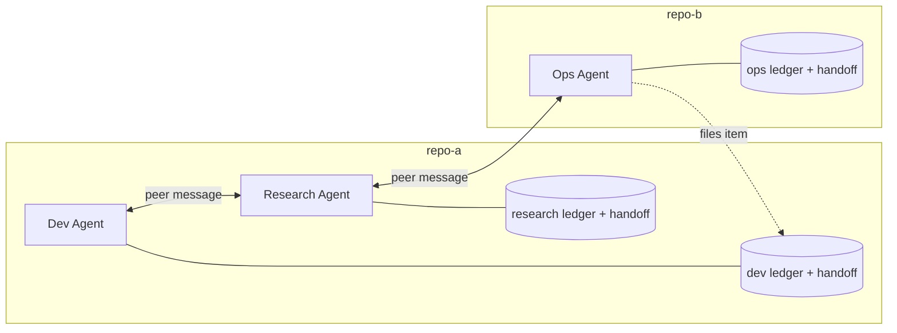

# Agents, ledger and handoff

> **Orchestration-based Workflow is now the primary workflow**: one stateful Orchestrator driving stateless,
> skill-based workers in temporary worktrees. Its contract is [orchestration.md](orchestration.md). This document
> covers the state contract both workflows share (Part 1) and **Multi-Agent Collaboration (legacy workflow)**, where
> named Agents work as peers (Part 2).

The previous Apex lives in `example/` as a reference only.

# Part 1: Shared state contract

## Fixed opinions

- No planning step. The plan is a ledger item.
- A stateful role (the Orchestrator, or a Collaboration Agent) owns exactly one ledger and one handoff, one per ticket
  in per-ticket mode.
- A handoff's startup procedure points at the role's live notes, which replace harness memory.
- State lives in the state directory `<state>/`: `.apex/` in the `apex` layout. Skills live in `.agents/skills/`, and
  `AGENTS.md` frames every session. The skill, ledger, handoff and shared notes are tracked; each role's private
  folder ignores itself and stays in the main checkout.
- Binary-light: Go only where the answer must be deterministic.
- Model and harness agnostic: roles ask for a capability tier, and harness tools are named only in the
  [Harness primitives](orchestration.md#harness-primitives) table.
- Review skills are optional. A role runs any review skill the repo provides, and reviews by hand when none exists.
- The protocol skills install as user skills, so they keep bare names (`/apex-init`).
- Replies follow the `reply-style` skill: answer first, terse, ledger items cited by id, a completion claim backed by
  the command that proved it.
- Git is governed by a git-discipline skill with per-repo conventions; push and PR happen only on the operator's word.

## Resolving paths

`apex where [--agent <a>] [--json]` prints every path below, so no skill derives one by hand.

| Key | `apex` layout | Legacy layout |
|---|---|---|
| `root` | the main checkout | the same |
| `state` | `.apex` | `.claude` (legacy) |
| `skills` | `.agents/skills` | `.claude/skills` (legacy) |
| `framing` | `AGENTS.md` | `CLAUDE.md` (legacy) |
| `workers` | `.apex/workers` | the same |
| `live`, `git`, `tiers` | `<state>/LIVE.md`, `<state>/git.md`, `<state>/tiers.md` | the same |
| `skill`, `ledger`, `handoff`, `private` (with `--agent`) | the role's skill file, ledger directory, handoff and private folder | the same |

## Layout

```
<root>/
  AGENTS.md                         framing
  .agents/skills/<role>/SKILL.md    the role's skill, user-owned; body lists the skills to pre-load
  .apex/                            <state>
    <role>/.gitignore               one line, *: the folder ignores itself
    <role>/LIVE.md                  live notes, role-owned; replaces memory
    <role>/RULES.md                 what the operator allows
    <role>/skills/*.md              reminder skills, role-owned
    LIVE.md                         shared notes: facts true for every role in this repo
    git.md                          this repo's commit, push and PR conventions
    tiers.md                        capability tier to model, per harness
    ledger/<role>/NNN.md            one item per file, never deleted
    ledger/<role>/handoff.md        one file, overwritten
    ledger/<role>/per-ticket        optional marker: one ledger per ticket instead
    ledger/<role>/concurrent        optional marker: several items may be in progress
    ledger/<role>/<ticket>/         a ticket's own NNN.md items and handoff.md
    workers/                        worker manifests and worktrees; ignores itself
```

The skill and the private folder are separate so the role can keep notes without rewriting its own skill. The role
reads the private folder with file reads at start rather than embedding it. The folder lives only in the main
checkout; a worktree reads it through `<root>`.

| File | Holds | Written by |
|---|---|---|
| `LIVE.md` | facts about the current state that outlive one item | the role |
| `RULES.md` | what the operator has decided the role may do | the role, only from the operator's words |
| `skills/<topic>.md` | reminders on how to do the work: traps, good-to-knows, do's and don'ts, one topic per file | the role |

A rule starts with `Allowed:` and grants one specific action: what, on what, when. It carries no date and no history,
and holds no prohibition or trap; those go in a reminder skill. What no rule allows needs the operator's approval.

A reminder skill never overrides the role's skill or the protocol. It is plain markdown read with a file read, never
discovered or invoked by a harness.

`<state>/LIVE.md` holds facts every role in the repo needs, kept once. Every role reads it at start, after its own
`LIVE.md`, and any role may edit it.

## Mono, per-ticket and concurrent ledgers

Two markers in the ledger directory change how `apex` treats it. Only the operator, or `apex-init` on the operator's
word, creates or deletes them.

- **Mono** (no marker): one ledger and one handoff across every branch, worktree and ticket.
- **Per-ticket** (`per-ticket`): every `apex` verb works on `ledger/<role>/<ticket>/`, a full ledger with its own ids
  from 001, its own in-progress items and its own `handoff.md`. `<ticket>` is the ticket id in the current checkout's
  branch, upper-cased (`feat/eng-42-login` gives `ENG-42`), or the branch name with `/` as `-` when it names none. A
  detached HEAD or a directory outside git falls back to the mono ledger. `apex list` prints `ledger: <dir>` first.
- **Concurrent** (`concurrent`): lifts the one-in-progress limit, so an Orchestrator can drive several items at once.

## Ledger item

The binary owns the frontmatter; the model owns the body.

```
---
id: 007
title: one line
kind: task | followup
status: open | in-progress | closed
created: 2026-09-30
closed: 2026-10-01
reason: one line
---
## Goal       From: <who asked: user, 003, repo:role/004>; what done means, checkable
## Approach   direct | subagent | worker | fan-out, and why
## Log        one line per step; the crash cursor
## Outcome    written at close
```

An item too big for one pass closes with `reason: split: 008-010`, and the children are added. Every reason starts
`done: `, `dropped: ` or `split: `.

`open -> in-progress -> closed`; `close` also works from open; `reopen` returns either to open. At most one item is
in progress unless the ledger holds `concurrent`.

`apex retitle <id> <title>` replaces a title in any status, and a wrong close reason is fixed with `reopen` then
`close`, which also moves `closed:` to the day of the correction.

| Exit | Meaning |
|---|---|
| 0 | ok |
| 1 | not found |
| 2 | environment |
| 3 | illegal transition |
| 4 | corrupt state |
| 5 | merge conflict (`apex worker merge`) |
| 64 | usage |

Every stateful `apex` verb takes an explicit `--agent`. There is no default role. Workers and subagents never run a
stateful verb.

## Handoff

The handoff is a markdown file the role writes and reads with ordinary commands; the binary has no handoff verb. Its
format and startup steps live in `state-protocol`.

```
---
checkout: <absolute path of the checkout worked in>
branch: <git rev-parse --abbrev-ref HEAD>
head: <git rev-parse HEAD>
---
## Startup     invoke the role's skill (reads its private folder and <state>/LIVE.md); apex list --agent <role>
## State       current items and where they stopped, uncommitted work, live workers
## Next
## Open threads
```

The handoff is stale when the recorded checkout no longer exists, its branch differs, or the code outside the state
directory differs from `head` in either direction: `git diff --quiet <head> HEAD -- . ':(exclude)<state>'` exits
non-zero, which also covers a branch moved backward and a `head` git no longer knows. Committing the handoff, ledger or
`LIVE.md` never makes it stale. `head` is always the full SHA. A stale handoff is still read; staleness tells the role
to reconcile State against what changed.

## Git discipline

The `git-discipline` skill keeps Conventional Commits, a terse subject, a body only for a non-obvious why, and no AI
attribution. It adds three things.

1. **Per-repo conventions** in `<state>/git.md`: message format, branch naming, ticket prefixes, remotes, PR
   template. The skill reads that file first and falls back to its defaults for anything unstated.
2. **Permission defaults.**

| Action | Default |
|---|---|
| Commit | on the operator's approval, or automatically when `<state>/git.md` says so |
| Push | on the operator's approval only |
| PR | only when the operator asks for one |
| Worker merge-back | on the operator's request, or when a `RULES.md` line allows it after verification |

The role never reminds the operator to open a PR, and says nothing about pushing until the operator gives Sign off. A
worker commits freely on its own temporary `apex/<id>-<slug>` branch; that branch is never pushed.

3. **Few commits.** A commit is a unit someone would review or revert on its own, never a save point. A role considers
   a commit only when a ledger item closes, at Sign off, or before a branch switch, rebase or worktree removal, and
   commits only when the work is whole, stands alone under its subject line, and is more than state-directory
   bookkeeping. The check is silent. A direct order to commit skips it.

## Session start and Sign off

`apex-init` adds a short section to `AGENTS.md` that frames every session.

- **Start:** invoke the role's skill: `/orchestrator`, or `/<agent>` for a Collaboration Agent.
- **Sign off:** the operator's notice to end a session, handled by the `sign-off` skill. The role then:
  1. logs where each in-progress item stopped, or closes it;
  2. updates its private folder and `<state>/LIVE.md`;
  3. audits workers: `apex worker list`; prunes clean merged ones, asks about unmerged ones;
  4. writes the handoff, naming any worker left active;
  5. cleans up what the session started: scratch files, servers, merged worktrees;
  6. commits the session's state-directory changes per git-discipline, in `<root>`, staging only the paths the session
     changed;
  7. reports unpushed commits, leaving out worker branches. This is the only point where pushing comes up.

## Memory

Harness memory is off, and `LIVE.md` replaces it. How to turn it off depends on the harness; see
[Harness primitives](orchestration.md#harness-primitives).

## Init and migrate

A repo adopts the protocol in a single-use session that runs the `apex-init` skill.

| State found | Outcome |
|---|---|
| No roles, no ledgers | blank slate: Orchestration-based Workflow by default, Multi-Agent Collaboration on request |
| Role skills, ledgers or handoffs in a foreign layout | migrate |
| A legacy `.claude/` layout | move it to `.apex/`, `.agents/skills/` and `AGENTS.md`, on request |
| Already follows the rules | report conformant, change nothing |

The binary has no init or migrate verb. The skill moves files and rewrites them, and files ledger items through
`apex add`. Migration renumbers each role's items from 001 in old order and rewrites every in-repo reference to an old
number; references in other repos are listed for the operator. Facts several roles share go to `<state>/LIVE.md`,
once.

## PR review

`/pr-review <pr> [mode]` makes the session the Master Reviewer for one pull request. It owns no ledger and no handoff.
Its roles run at capability tiers: reviewers at `standard`, security reviewers at `security`, judges and editor at
`deep`, auditors at `audit`. The skill holds the rest.

## Open questions

1. `apex-init` detection: which signals prove a repo conformant. Evolving by design: implement first, dry-run on a
   real migration, then calibrate.

# Part 2: Multi-Agent Collaboration (legacy workflow)

Named Agents that each own a ledger and work as peers. New setups use the Orchestration-based Workflow; this one stays
for repos that run it and for work split across several home repos.

## What an Agent is

An Agent is a user-defined skill with `metadata.kind: agent`. The operator names it at session start; nothing selects
it automatically. Any number of Agents can be active in one repo at once, and they work independently or collaborate.

An Agent defines two things:

1. What to pre-load: other skills, listed in its body.
2. What it owns: one ledger and one handoff.

An Agent's skill, ledger and handoff live in its home repo. It may work in other repos, but its state never moves
there: it notes the other repo in the ledger item it is working.

An Agent executes an item directly, through a subagent, through one worker (`apex worker spawn`, as in
`orchestrator-protocol`), or through a fan-out of parallel workers. Subagents and workers own no state.



## Collaboration

- Peers talk through the harness's peer-messaging primitive: find the peer, then send it a message.
- A peer can file an item into another Agent's ledger; only the owner starts or closes it.
- An Agent that receives a request replies right away when it has no item in progress, and otherwise files the request
  in its own ledger and replies with the item id.
- Peer traffic stays out of the operator's chat: the Agent acknowledges in one line and never repeats to the operator
  what it sent to a peer, unless it needs the operator's answer.
- `apex-init` writes these rules into the repo's `AGENTS.md` section, so they hold before any skill loads.

### Claude Code harness

In Claude Code, `ListAgents` finds peers and `SendMessage` reaches them.

## Legacy layout

A repo set up before `.apex/` keeps everything under `.claude/` (legacy): `.claude/skills/<agent>/SKILL.md`,
`.claude/apex/<agent>/`, `.claude/ledger/<agent>/`, `.claude/LIVE.md`, `.claude/git.md`, framed by `CLAUDE.md`.
`apex where` reports `layout: legacy` and the protocol skills run unchanged; `apex-init` moves a legacy repo to the
`apex` layout on request. An Agent whose `LIVE.md` still sits tracked
next to its legacy skill moves to its private folder by [MIGRATION.md](../../MIGRATION.md).

### Claude Code extras

`mods/` holds optional Claude Code plugins with a hooks module, such as `token-spend` for `/spend`, and the optional
`Apex` output style mirrors `reply-style` for Claude Code. Neither is part of the protocol.
