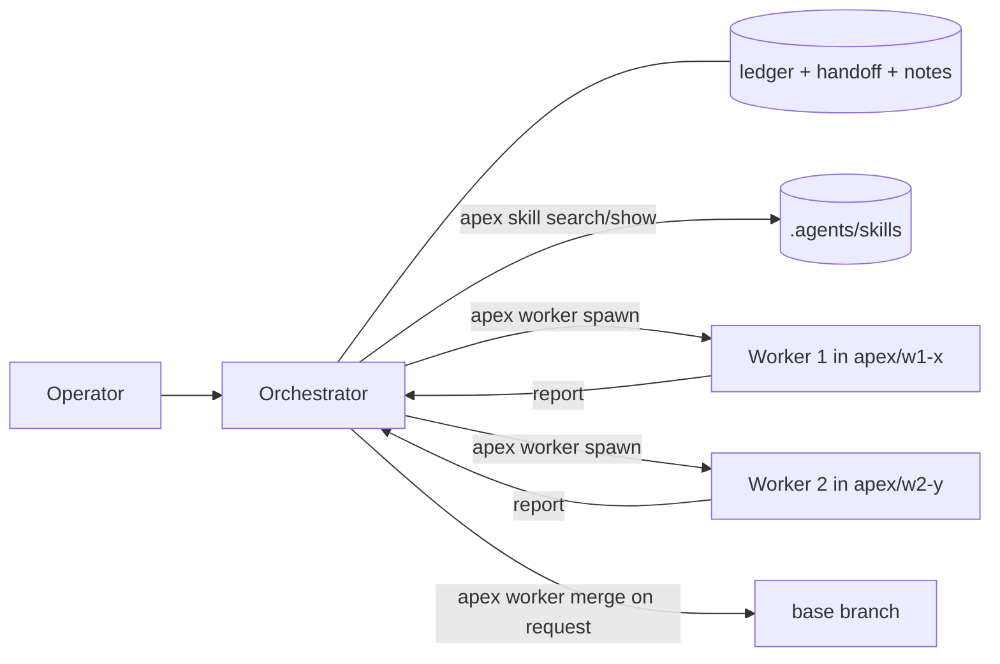
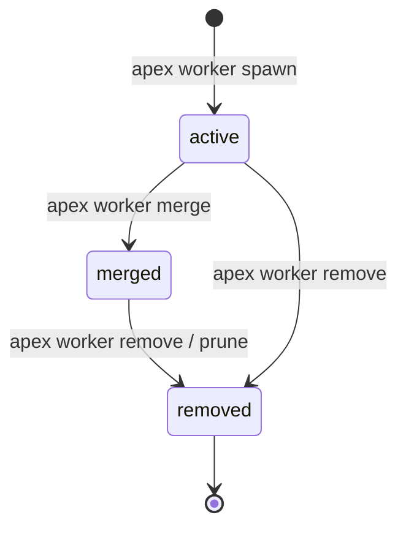

# Orchestration-based Workflow

The primary Apex workflow. One stateful Orchestrator owns the ledger and the handoff. It routes each work item to
stateless workers, and each worker runs one or more worker skills in a temporary worktree of its own. The shared state
contract (ledger, handoff, notes, git discipline, sign off) is in [agents.md](agents.md) Part 1. The older
peer-to-peer workflow, Multi-Agent Collaboration, is in [agents.md](agents.md) Part 2, and both can run in one repo.

## Fixed opinions

- **One stateful Master Orchestrator.** It is the only role that writes the ledger, the handoff and the notes. It
  plans nothing outside the ledger: the plan is a ledger item.
- **Many stateless workers.** A worker gets a brief, works in its own worktree, commits there and reports. It owns no
  state, writes no ledger or handoff, and keeps no memory. Its run ends with its report.
- **Skill-based workers.** What a worker knows comes from the worker skills the Orchestrator assigns. There are no
  built-in worker personalities.
- **A temporary worktree and branch per worker.** `apex worker spawn` creates both, and `apex worker remove` or
  `prune` deletes both. A harness that creates the worktree itself hands it over with `apex worker adopt`. Workers never share a checkout, so concurrent workers never touch each other's files.
- **Progressive skill discovery.** A repo can hold hundreds of skills. The Orchestrator searches metadata and loads
  one skill's body only once a worker needs it, and never bulk-reads a skills directory.
- **Model and harness agnostic.** Roles ask for a capability tier, never a model. Harness-specific mechanics appear
  only in [Harness primitives](#harness-primitives).
- **Binary-light.** `apex` covers only what must be deterministic: ledger transitions, layout resolution, worker
  worktrees and skill metadata. Everything else is a skill the model reads.
- **Merge-back only on request or policy.** A worker's branch merges into its base only when the operator asks, or,
  after verification, when `<state>/git.md` says `Worker merge: after verification` or a `RULES.md` line allows it.

## Roles

| Role | State | Does | Defined by |
|---|---|---|---|
| Orchestrator | stateful: ledger, handoff, notes | picks items, routes them to skills, spawns, watches and verifies workers, merges back on request | `.agents/skills/orchestrator/SKILL.md` plus `orchestrator-protocol` |
| Stateless Worker | none | runs one brief in its worktree, commits, verifies, reports | the brief plus `worker-protocol` and its worker skills |
| Worker Skill | none | knowledge for one kind of work: how to implement, review, research, migrate | `.agents/skills/<name>/SKILL.md` with `metadata.kind: worker-skill` |
| Operator | decides | starts sessions, approves commits, pushes and merges, grants rules, says "sign off" | the human |



## Layout

```
<root>/
  AGENTS.md                           framing every session reads first
  .agents/skills/<name>/SKILL.md      skills: the Orchestrator, worker skills, other skills
  .agents/skills/<domain>/<name>/SKILL.md   optional domain grouping, addressed as domain/name
  .apex/
    LIVE.md                           shared notes for every role in this repo
    git.md                            commit, push and PR conventions
    tiers.md                          capability tier to model, per harness
    orchestrator/                     private folder; .gitignore holds *
      LIVE.md  RULES.md  skills/<topic>.md
    ledger/orchestrator/NNN.md        ledger items
    ledger/orchestrator/handoff.md    handoff
    ledger/orchestrator/concurrent    marker: several items may be in progress
    workers/                          .gitignore holds *; nothing here is tracked
      <id>.json                       worker manifest, written by apex
      <id>.brief.md                   optional brief, written by the Orchestrator
      <id>/                           the worker's worktree
```

`<root>` is the main checkout, also when a session runs in a worktree. Never derive paths by hand: `apex where`
prints them.

| `apex where` key | Value |
|---|---|
| `root` | the main checkout |
| `layout` | `apex` or `legacy` |
| `state` | `.apex` (or `.claude` in the legacy layout) |
| `skills` | `.agents/skills` (or `.claude/skills` in the legacy layout) |
| `framing` | `AGENTS.md` (or `CLAUDE.md` in the legacy layout) |
| `workers` | `.apex/workers` |
| `live`, `git`, `tiers` | the shared `LIVE.md`, `git.md` and `tiers.md` |
| `skill`, `ledger`, `handoff`, `private` | with `--agent <a>`: that role's skill file, ledger directory, handoff and private folder |

Below, `<state>`, `<workers>` and `<ledger>` stand for the values `apex where` prints. `--json` prints the same keys
as one object.

### Legacy layout

A repo set up before this workflow keeps everything under `.claude/`: `.claude/skills/`, `.claude/ledger/`,
`.claude/apex/<agent>/`, `.claude/LIVE.md`, `.claude/git.md`, with `CLAUDE.md` as the framing file. `apex where`
reports `layout: legacy` and resolves every key into it, so the protocol skills run unchanged. Worker manifests live in
`.apex/workers/` in both layouts. `apex-init` moves a legacy repo to the `apex` layout on request.

## Harness primitives

Skills name a primitive ("delegate to a worker", "load a skill"), never a harness tool. This table maps the primitives
for each harness. It is the only place a harness tool is named.

| Primitive | Claude Code harness | Codex harness | T3 Code harness | Generic CLI or MCP harness |
|---|---|---|---|---|
| Framing file | `CLAUDE.md` containing `@AGENTS.md` | `AGENTS.md` | `AGENTS.md` (`CLAUDE.md` containing `@AGENTS.md` on Claude threads) | `AGENTS.md`, or a system prompt that includes it |
| Skill load | the Skill tool, or a file read of `SKILL.md` | a file read of `SKILL.md` | skill discovery, or a file read of `SKILL.md` | a file read of `SKILL.md` |
| Delegate (foreground) | the Agent tool, blocking | a spawned sub-agent, then wait | `orchestrator_capabilities` once per thread, then `delegate_task` with `mode: "wait"` and `isolation: "worktree"` | a child process or MCP call that returns the report |
| Background delegate | the Agent tool in the background | a spawned sub-agent, not awaited | `delegate_task` with `mode: "async"` and `isolation: "worktree"`; a reactive wakeup lands the result, never poll `task_status` | a detached child process whose report lands in a file |
| Workflow runner | the Workflow tool, only when the operator opts in | none: background delegates | scriptable workflows (`run_workflow`) only when the operator asks; else parallel `delegate_task` calls | none: background delegates |
| Peer messaging (Collaboration only) | `ListAgents` and `SendMessage` | none | `t3_thread_send` and `t3_thread_read` | none, or an MCP messaging server |
| Reply style | the `reply-style` skill; the `Apex` output style is an optional Claude Code extra | the `reply-style` skill | the `reply-style` skill (the `Apex` output style on Claude threads) | the `reply-style` skill |
| Memory off | `.claude/settings.json` holding `"autoMemoryEnabled": false` | no automatic memory to turn off | rely on `.apex/` state (`AGENTS.md`) | turn off any memory the harness keeps |

Worktree isolation has two modes, and a repo uses whichever its harness supports.

1. **The Orchestrator delegates into a caller-specified `cwd`.** The Claude Code, Codex and generic harnesses take the
   working directory from the caller. `apex worker spawn` creates `<workers>/<id>/`, the delegate runs there, and the
   harness's own worktree isolation, such as the Claude Code Agent tool's `isolation: "worktree"`, is never used:
   `apex` owns the worktree, so the manifest, the branch name and merge-back stay deterministic.
2. **The harness owns child worktree isolation.** The T3 Code harness creates the child worktree and branch itself,
   through `delegate_task` with `isolation: "worktree"`. The Orchestrator lets it, then registers the result with
   `apex worker adopt <worktree-or-branch>`. From then on `apex worker list`, `status`, `merge` and `prune` track the
   adopted worker exactly like a spawned one. `remove` and `prune` untrack an adopted worker without deleting the
   harness's worktree or branch, unless `--purge` is passed.

## Capability tiers

Roles and worker skills ask for a tier. `<state>/tiers.md` maps each tier to a model for each harness the repo uses,
and the Orchestrator passes the mapped model to the delegate primitive. A tier with no mapping runs on the harness
default model.

| Tier | For |
|---|---|
| `fast` | search, lookups, mechanical edits, formatting |
| `standard` | most implementation and review work |
| `deep` | design, hard debugging, judging between answers |
| `audit` | a second, independent check of another model's verdict |
| `security` | security review; a lens that needs it stops when no model is mapped |

## Skills

### Frontmatter

Every skill follows the Agent Skills format: YAML frontmatter, then a markdown body. `apex skill check` validates it.

```yaml
---
name: implement                         # the directory name, ^[a-z0-9][a-z0-9-]{0,63}$
description: "Implement one scoped code change on the worker branch and verify it."   # one line
metadata:
  kind: worker-skill                    # orchestrator | worker-skill | agent | protocol | skill
  tier: standard                        # optional: fast | standard | deep | audit | security
  tags: "code, change, feature, fix"    # optional, comma-separated
  domain: "backend"                     # optional
  inputs: "goal, scope, verify command" # optional, what the brief must give
  outputs: "commits, completion report" # optional, what the worker returns
  verify: "the brief's Verify command passes"   # optional
  requires: "git-discipline"            # optional, skills loaded with this one
---
```

`metadata` values are strings, as the Agent Skills format requires; a list is a comma-separated string. `kind`
decides who may load the skill: the Orchestrator never runs a `worker-skill` itself, and a worker never loads an
`orchestrator` or `agent` skill.

### Roots

`apex skill` reads these roots in order. The first root holding a name wins, and `domain/name` picks one when names
collide.

1. `<root>/.agents/skills`
2. `<root>/.claude/skills` (legacy layout)
3. `$APEX_SKILLS_DIR`
4. `~/.agents/skills`
5. the harness user skill directories: Claude Code, Codex, T3 Code (all four roots) and Gemini
   (`${GEMINI_CONFIG_DIR:-~/.gemini/config}/skills`, so `.gemini/config/skills` by default)

### Progressive routing

The Orchestrator learns about skills in three levels and stops at the first level that answers the question.

| Level | Command | Reads |
|---|---|---|
| 1. Find | `apex skill search <query...> [--kind worker-skill] [--tag <t>] [--limit <n>]`, or `apex skill list --kind worker-skill` | name, description, tags: one line per skill |
| 2. Decide | `apex skill show <name>` | full frontmatter: tier, inputs, outputs, verify, requires, path |
| 3. Use | the worker loads the body from the path `show` printed | one skill body, inside the worker |

The Orchestrator never reads `.agents/skills/` itself, never loads hundreds of descriptions into its context, and
passes `--body` to `show` only when it must run a skill itself as a fallback. `apex skill check [<path-or-name>]`
validates frontmatter after any skill is written.

## Workers

### Lifecycle



| Verb | Does | Requires |
|---|---|---|
| `apex worker spawn <slug> [--base <branch>] [--skill a,b] [--item <ref>]` | creates branch `apex/<id>-<slug>` from `<base>` (default: the branch checked out in the current directory) and its worktree `<workers>/<id>/`; prints `id`, `worktree`, `branch`, `base` | a valid slug |
| `apex worker adopt <worktree-or-branch> [--slug s] [--base b] [--skill a,b] [--item ref]` | registers a worktree and branch a harness created (such as T3 Code's `delegate_task` with `isolation: "worktree"`) as a worker, with a manifest like a spawned one's; prints `id`, `worktree`, `branch`, `base` | an existing worktree or branch |
| `apex worker list [--state active,merged\|all]` | one row per worker: state, `worktree` `ok`, `missing` or `drift`, `ahead`/`behind`, `dirty`, `branch -> base`, skills, item | |
| `apex worker status <id>` | the same for one worker | |
| `apex worker merge <id> [--message <msg>]` | `--no-ff` merge of the branch into `<base>`, in the checkout holding `<base>`; state becomes `merged` | `dirty == 0`, `ahead > 0`, a clean index in that checkout |
| `apex worker remove <id> [--force] [--purge]` | removes the worktree and branch of a spawned worker; state becomes `removed`. An adopted worker is only untracked, and its worktree and branch stay unless `--purge` is passed | `dirty == 0` and `ahead == 0`, or `--force` |
| `apex worker prune` | removes every clean `merged` worker (untracking adopted ones) and prunes stale git worktrees | |

Every worker verb is repo-scoped, takes no `--agent`, and prints JSON with `--json`. The exit codes are those of the
ledger verbs, plus `5`: `apex worker merge` hit a conflict, aborted the merge cleanly and listed the conflicting files.

The manifest `<workers>/<id>.json` belongs to `apex`: nobody edits it. `<workers>/.gitignore` holds `*`, so manifests,
briefs and worktrees never reach git.

### Brief

What the Orchestrator gives a worker, inline in the delegate prompt or as `<workers>/<id>.brief.md`.

```
## Goal      what done means, checkable; From: orchestrator/<item id>
## Inputs    files, prior reports, links the worker needs
## Scope     paths it may change, and what it must leave alone
## Verify    the command that proves done, run in the worktree
## Sync      yes | no: whether to bring <base> in before reporting
```

The delegate prompt also names the worktree path, `worker-protocol`, and the path of each assigned skill as
`apex skill show` printed it.

### Report

The worker's last message, and the only thing it returns.

```
## Summary       one paragraph: done, partly done, or blocked
## Changes       commits on the worker branch (short SHA and subject), files touched
## Verification  each command run and its result
## Notes         what the Orchestrator should know: risks, follow-ups found
## Blockers      what stopped it, or none
```

### Flow

1. **Pick.** The Orchestrator starts a ledger item: `apex start <id> --agent orchestrator`.
2. **Route.** It finds worker skills with progressive routing and picks a tier from each skill's `metadata.tier`.
3. **Spawn.** `apex worker spawn <slug> --skill <a,b> --item orchestrator/<id> [--base <branch>]`. On a harness that
   owns child worktrees, skip this step: the harness creates the worktree in step 4 and `apex worker adopt` registers it.
4. **Brief and delegate.** It writes the brief and calls the delegate primitive at the worktree path, with the model
   for the tier. On a harness that owns child worktrees it delegates with that harness's worktree isolation, then runs
   `apex worker adopt <worktree-or-branch> --skill <a,b> --item orchestrator/<id>` on the result.
5. **Watch.** `apex worker list` and `apex worker status <id>` show progress while workers run; the item's Log gets
   one line per spawn, report and verdict.
6. **Verify.** For each report it reads `git -C <wt> log <base>..HEAD --oneline` and `git -C <wt> diff --stat
   <base>...HEAD`, and reruns the brief's Verify command in `<wt>`. A large diff gets a `review` worker of its own.
7. **Merge back.** Only on request or policy: `apex worker merge <id>`.
8. **Clean up.** `apex worker remove <id>` for a worker whose work is dropped, `apex worker prune` for merged ones.

## Concurrency

- A ledger holds at most one in-progress item. The `concurrent` marker in `<ledger>/` lifts that limit, so the
  Orchestrator can drive several items at once. `apex-init` creates it for the Orchestrator.
- At most 10 workers are live at once, unless a `RULES.md` line raises the cap.
- Fan-out is several workers on independent slices of one item, each in its own worktree. A harness workflow runner
  may drive the fan-out only when the operator opts in.

## Conflicts

Workers branch from the same base and may conflict at merge-back. `apex worker merge` exits `5`, aborts the merge and
lists the files. The Orchestrator then sends a sync step to that worker's worktree: merge or rebase `<base>` there,
resolve, rerun Verify, commit. Then it retries `apex worker merge <id>`. A conflict is never resolved in the base
checkout.

## Sign off

Sign off audits workers before the handoff: `apex worker list`. An active worker with commits not merged, or with
uncommitted changes, is reported and the operator decides; nothing unmerged is removed without that decision. Clean
`merged` workers are pruned. Workers left active are named in the handoff's State with id, branch and item. The
unpushed-commit report leaves out `apex/*` worker branches, which are temporary and never pushed.

## Init

`apex-init` sets the workflow up from a blank slate: the Orchestrator skill, its private folder and ledger with the
`concurrent` marker, `<workers>/.gitignore`, `.apex/{LIVE.md,git.md,tiers.md}`, the starter worker skills
`implement`, `review` and `research`, and the `AGENTS.md` section. A Claude Code adapter (`CLAUDE.md` holding
`@AGENTS.md`, memory off) is added only for a repo that uses Claude Code.

## PR review

`pr-review` is a skill of its own, not an Orchestrator. It runs its reviewer, judge and auditor roles at capability
tiers and needs no ledger. An Orchestrator may hand a pull request to it, and a worker may load it as a review skill.

## Coexistence with Multi-Agent Collaboration

An Orchestrator and Collaboration Agents can share one repo. Each owns its own ledger under `<state>/ledger/`, and
they share `<state>/LIVE.md` and `<state>/git.md`. The Orchestrator is not a peer: it is reached by the operator, and
it files work into a Collaboration Agent's ledger the way a peer would (`apex add ... --agent <peer>`). A
Collaboration Agent may itself spawn workers; then it follows the worker sections of `orchestrator-protocol`.
